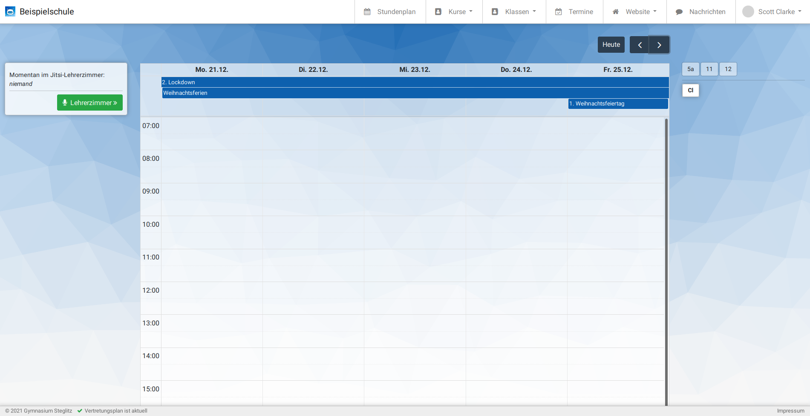

# Daten

Woher kommen die Daten im Dashboard und wie werden sie verarbeitet?

Zum Einstieg dienen die Dateien unterhalb von 
`src/example-data/`, die im Folgenden beschrieben 
werden (inkl. eigener Eingaben).

Später kommen diese Daten natürlich per Schnittstelle aus den jeweiligen 
Quellsystemen wie WinSchule oder Untis. Wir werden nach und nach die 
Dokumentation um bereits angebundene Systeme erweitern.


## Schuljahr

Das Schuljahr wird in der Datei 
`src/example-data/config.yaml` konfiguriert und enthält 
Beginn- und Ende-Datum des Schuljahres sowie den ersten Schultag.

```{.yml} 
---
:first_day: '2024-08-25'
:first_school_day: '2024-08-25'
:last_day: '2025-07-17'
```

## Ferien + Feiertage

Ferien, Feiertage und sonstige freie Tage (ohne Stundenplan!) werden 
durch den Aufruf von `./update-timetables.rb` aktualisiert (siehe 
[Installationsanweisung](file.Installation.html)). In unserer Testumgebung 
stehen die Daten dazu in 
`src/example-data/ferien_feiertage/ferien_feiertage.csv`.

Diese Datei hat drei Spalten und sieht wie folgt aus:

```{.csv}
Beginn,Ende,Titel
2019-06-20,2019-08-02,Sommerferien
2019-10-03,,Tag der Deutschen Einheit
2019-10-04,,Unterrichtsfrei
2019-10-07,2019-10-19,Herbstferien
2019-12-23,2020-01-04,Weihnachtsferien
2019-12-25,,1. Weihnachtsfeiertag
2019-12-26,,2. Weihnachtsfeiertag
2020-01-01,,Neujahr
2020-02-03,2020-02-08,Winterferien
2020-03-08,,Internationaler Frauentag
2020-04-06,2020-04-17,Osterferien
2020-04-10,,Karfreitag
2020-04-13,,Ostermontag
2020-05-01,,Tag der Arbeit
2020-05-08,,Tag der Befreiung
2020-05-21,,Christi Himmelfahrt
2020-05-22,,Pfingstferien
2020-06-01,,Pfingstmontag
2020-06-25,2020-08-07,Sommerferien
2020-10-03,,Tag der Deutschen Einheit
2020-10-12,2020-10-24,Herbstferien
2020-12-21,2021-01-02,Weihnachtsferien
2020-12-25,,1. Weihnachtsfeiertag
2020-12-26,,2. Weihnachtsfeiertag
2021-01-01,,Neujahr
2021-02-01,2021-02-06,Winterferien
2021-03-08,,Internationaler Frauentag
2021-03-29,2021-04-10,Osterferien
2021-04-02,,Karfreitag
2021-04-05,,Ostermontag
2021-05-01,,Tag der Arbeit
2021-05-13,,Christi Himmelfahrt
2021-05-14,,Pfingstferien
2021-05-24,,Pfingstmontag
2021-06-24,2021-08-06,Sommerferien
```

Die Beispieldatei enthält nur Termine bis 2021 – für einen eigenen Test
mit dem aktuellen Schuljahr die Termine entsprechend ergänzen.

Hier können wir eigene Daten ergänzen. Neue Termine können wir einfach 
am Ende einfügen, es dient aber natürlich der besseren Übersicht diese 
gleich zeitlich richtig einzusortieren (z.B. `2020-12-16,2021-02-21,2. 
Lockdown` -- natürlich nur, wenn an diesen Tagen weder Aufgaben noch 
Homeschooling vorgesehen sind). Ein einzelner Tag wird einfach ohne 
Ende-Datum eingetragen (`2021-04-01,,Impfung Lehrkräfte`).

Die freien Tage werden im Kopfbereich des Kalenders angezeigt. An 
diesen Tagen gibt es keinen Stundenplan. Es können auch mehrere Termine 
an denselben Tagen gültig sein, wie man an folgendem Beispiel sehen 
kann: 




## Stundenplan

Der Stundenplan unserer Beispielumgebung liegt in 
`src/example-data/stundenplan/2024-08-25.TXT`. Änderungen am 
Stundenplan werden wie auch die Ferien und Feiertage mit 
`./update-timetables.rb` aktualisiert. Dabei ist zu beachten, dass 
**Änderungen immer ab dem Datum** des Dateinamens gelten.

Wenn wir also eine Raumänderung von Anfang an vornehmen wollen, können 
wir dies direkt in der Datei `2024-08-25.TXT` machen (erster Schultag 
SJ 2024/2025). Soll eine Änderung erst ab einem bestimmten Datum 
gelten, so legen wir zu diesem Datum eine neue Datei an. Wenn man 
keinen komplett neuen Stundenplan erstellen möchte, kann man den 
letzten gültigen kopieren und dann dort anpassen, also z.B. mit `cp 
2024-08-25.TXT 2025-03-31.TXT`. In der Regel wird man diesen aber aus 
dem System exportieren, mit dem der Stundenplan auch erstellt wurde, 
z.B. Untis.

Die Stundenplandatei hat folgenden Aufbau (und im Vergleich zu den 
Ferien keine Überschriftenzeile):

```{.txt}
2       "5a"    "Cl"    "Ma"    "109"   2       3
2       "5a"    "Cl"    "Ma"    "109"   2       4
2       "5a"    "Cl"    "Ma"    "110"   3       1
2       "5a"    "Cl"    "Ma"    "108"   4       1
2       "5a"    "Cl"    "Ma"    "108"   5       1
6       "5a"    "Cl"    "Nawi"  "317"   2       6
6       "5a"    "Cl"    "Nawi"  "317"   2       7
6       "5a"    "Cl"    "Nawi"  "323"   4       2
6       "5a"    "Cl"    "Nawi"  "323"   4       3
1083    "11"    "Cl"    "LA-L108"       "129"   1       2
1083    "11"    "Cl"    "LA-L108"       "129"   1       3
1083    "11"    "Cl"    "LA-L108"       "129"   3       2
1083    "11"    "Cl"    "LA-L108"       "129"   3       3
1083    "11"    "Cl"    "LA-L108"       "129"   5       8
1083    "12"    "Cl"    "LA-L108"       "129"   1       2
1083    "12"    "Cl"    "LA-L108"       "129"   1       3
1083    "12"    "Cl"    "LA-L108"       "129"   3       2
1083    "12"    "Cl"    "LA-L108"       "129"   3       3
1083    "12"    "Cl"    "LA-L108"       "129"   5       8
```

Hierbei sind die Spalten mit Tabs getrennt und Textfelder stehen in 
Anführungsstrichen. Die Spalten haben folgende Bedeutungen:

| Spalte | Bedeutung                                                                   |
| ------ | --------------------------------------------------------------------------- |
|      1 | Unterrichts-ID aus Untis                                                    | 
|      2 | die Klasse (Umbenennungen: `PARSE_KLASSE_TR` in `credentials.rb`, `KLASSEN_TR` in `/data/config.rb`) |
|      3 | Kürzel der Lehrkraft (siehe `lehrer/lehrer.csv`)                            |
|      4 | Kürzel des Fachs (siehe `faecher/faecher.csv`)                              |
|      5 | Raumnummer                                                                  |
|      6 | Wochentag (Mo=1, Di=2,...)                                                  |
|      7 | Stunde (die Stundenzeiten stehen in `/data/config.rb`, `fix_stundenzeiten`) |

Wir sehen hier auch, dass Kurse problemlos zusammengelegt werden 
können, z.B. findet der Latein-Leistungskurs gemeinsam für die 11. und 12. Klassen statt.


## Schüler:innen

Die Schüler:innen stehen in `schueler/` im Datenverzeichnis, eine Zeile pro
Schüler:in, die Spalten mit Tabs getrennt, ohne Überschriftenzeile. Es gibt
zwei Formen:

- **Datierte Listen** `schueler/JJJJ-MM-TT.TXT`, angelegt über die Seite
  **Datenpflege** (siehe unten). Das Dashboard nimmt die neueste Liste, deren
  Datum nicht in der Zukunft liegt. Eine Liste für ein späteres Datum wird so
  am Stichtag gültig.
- **`schueler/ASCII.TXT`** (Beispiel: `src/example-data/schueler/ASCII.TXT`),
  die alte Form, solange es noch keine gültige datierte Liste gibt.

```{.txt}
Mustermann	Max	5a	m	01.01.2010
Mustermann	Elisabeth	5a	w	02.01.2010	Elli
```

| Spalte | Bedeutung                                                              |
| ------ | ---------------------------------------------------------------------- |
|      1 | Nachname                                                               |
|      2 | Vorname(n)                                                             |
|      3 | Klasse                                                                 |
|      4 | Geschlecht: `m`, `w` oder `d`                                          |
|      5 | Geburtsdatum (`TT.MM.JJJJ`)                                            |
|      6 | Rufname (optional, sonst gilt der erste Vorname)                       |
|      7 | Bildungsgang (nur datierte Listen, optional)                           |
|      8 | E-Mail-Adresse (nur datierte Listen, optional)                         |
|      9 | früher der Schlüssel aus der LUSD; wird nicht mehr gelesen             |

Dabei ist zu beachten:

- Die **E-Mail-Adresse** ist die feste Kennung einer Person im Dashboard.
  In datierten Listen steht sie in Spalte 8 und bleibt so erhalten, auch wenn
  sich der Name ändert. Fehlt sie (und in `ASCII.TXT` immer), entsteht sie aus
  Rufname und Nachname.
- Die Klassen einer datierten Liste sind schon die Namen des Dashboards. In
  `ASCII.TXT` werden sie beim Einlesen noch mit `fix_parsed_klasse` und
  `PARSE_KLASSE_TR` umbenannt, und die Ersetzungsdateien für Namen und
  Adressen (`email-sub*.txt`, `first-name-sub*.txt`, `last-name-sub.txt`)
  gelten nur dort.
- Schüler:innen, deren Klasse nicht in `KLASSEN_ORDER` steht, lässt das
  Dashboard weg.
- Ein anderes Geschlecht als `m`, `w` oder `d` bricht das Einlesen ab.

### Datenpflege im Dashboard

Wer Daten einspielen darf (Rolle `can_manage_data`, Admins haben sie immer),
findet unter
Admin → **Datenpflege** den Abgleich mit der LUSD:

1. Den Export aus der LUSD (Excel oder CSV) in das Feld ziehen und den Tag
   wählen, ab dem die Liste gelten soll.
2. Das Dashboard vergleicht mit der Liste, die an diesem Tag gilt, und zeigt
   alle Unterschiede: wer neu ist, wer nicht mehr dabei ist und was sich bei
   den übrigen ändert (Klasse, Name, Rufname, Bildungsgang, Geschlecht,
   Geburtstag), markiert wie in einem Diff.
3. Bisherige Schüler:innen werden über den Namen und den Geburtstag
   wiedergefunden und **behalten ihre Adresse**. Den Schüler-Schlüssel der
   LUSD nutzt das Dashboard nicht: Er bleibt nicht von einem Export zum
   nächsten gleich.
   Neue bekommen eine Adresse aus Rufname und Nachname, zu lange Adressen
   werden gekürzt. Die Adresse lässt sich vor dem Übernehmen ändern, und ein
   neuer Eintrag kann von Hand einem bisherigen Konto zugeordnet werden.
4. Die Klassennamen der LUSD werden den Klassen des Dashboards zugeordnet
   (Vorschlag aus der bisherigen Liste, änderbar). Die Zuordnung steht in
   `schueler/lusd-klassen.yaml`.
5. **Übernehmen** schreibt `schueler/JJJJ-MM-TT.TXT`. Eine vorhandene Liste
   für denselben Tag wird nur nach Bestätigung ersetzt. Danach lädt das
   Dashboard die Daten neu.
6. Jede Änderung (eine übernommene Liste, Rufname und Geschlecht im
   Dashboard) wird sofort im Daten-Repository committet und, wenn
   eingestellt, zum Server des Repositorys geschoben – es bleibt kein Schritt
   übrig, den man vergessen kann. Klappt das Schieben nicht, sagt die Seite
   es und bietet **Erneut schieben** an. Eine Liste für einen Tag, der noch
   kommt, lässt sich wieder **löschen**; bis dahin gilt die bisherige.

Fehler werden zuerst in der LUSD korrigiert. Das Dashboard speichert nur, was
die LUSD nicht kennt, vor allem die E-Mail-Adresse.

**Noch nicht in der LUSD, nicht mehr an der Schule:** Zwei Listen auf der Seite
Datenpflege überbrücken die Zeit, bis die LUSD stimmt. Beide gelten sofort und
für jede Liste, die das Dashboard liest, auch für Entwürfe; jeder neue Export
behält sie.

- *Noch nicht in der LUSD* (`schueler/zusaetzlich.yaml`): Schüler:innen, die
  schon da sind, aber noch nicht in der eigenen LUSD stehen (etwa weil die alte
  Schule sie noch nicht abgegeben hat). Sie bekommen sofort eine Adresse und
  zählen wie alle anderen. Enthält ein Export sie, übernimmt er die Adresse,
  und der Eintrag endet von selbst.
- *Nicht mehr an der Schule* (`schueler/abgaenge.yaml`): Schüler:innen, die
  gegangen sind, aber noch in der LUSD stehen. Für das Dashboard sind sie
  sofort weg. Der Eintrag endet von selbst, sobald keine Liste sie mehr
  enthält.

Ein Eintrag endet erst, wenn ihn keine Liste mehr braucht, die heute oder
später gilt (der Entwurf zählt dabei mit).

**Entscheidungen im Vergleich:** Die Listen des Vergleichs haben Knöpfe für
die häufigen Fälle:

- *Neu* – »Nicht mehr da«: steht in der LUSD, ist aber nicht (mehr) an der
  Schule; kommt auf die Liste *Nicht mehr an der Schule* (erkannt an Name und
  Geburtstag, da es noch kein Konto gibt).
- *Nicht mehr dabei* – »Ist doch da«: kommt mit der bisherigen Adresse auf
  *Noch nicht in der LUSD*; »Nicht mehr da« meldet sofort ab.
- *Weggelassen* (Klasse gibt es im Dashboard nicht) – »ist da, in Klasse …«:
  die Klasse von Hand (`schueler/klassen-von-hand.yaml`, gilt für jeden
  Export, solange die LUSD keine bekannte Klasse liefert); »Nicht mehr da«
  wie bei *Neu*.

Damit das Dashboard in das Daten-Repository schreiben darf, braucht es in
`env.rb` `DATA_REPO_WRITABLE = true` (und `DATA_REPO_PUSH = true` zum
Schieben); ohne diese Einstellungen ist das Datenverzeichnis wie bisher nur
lesbar.

Laufen die Dienste unter einem anderen Benutzer als dem, dem das
Daten-Repository gehört (`UID` in `env.rb`), muss das Repository für eine
gemeinsame Gruppe schreibbar sein (`chgrp`, `chmod g+rwX`, Verzeichnisse mit
`g+s`, `git config core.sharedRepository group`), und `DATA_REPO_GROUP` nennt
deren Nummer, damit der Web-Dienst ihr angehört.

Zum Schieben braucht der Server einen **Deploy Key** mit Schreibrecht nur für
das Daten-Repository: ein SSH-Schlüssel ohne Passphrase als
`data-repo-deploy-key` in `INTERNAL_PATH` (im Container `/internal`), dem
Benutzer des Dienstes gehörend und nur für ihn lesbar (`chmod 600`). Der
öffentliche Teil wird beim Daten-Repository als Deploy Key mit Schreibrecht
eingetragen, und dessen Remote muss eine SSH-Adresse sein (`git@…`); lauscht
der Git-Server nicht auf Port 22, gehört der Port in die Adresse
(`ssh://git@host:port/…`) – eine `~/.ssh/config` des Server-Benutzers gilt im
Container nicht. Ohne
Schlüssel bleiben die Commits im Checkout auf dem Server; die Seite sagt dann,
dass das Schieben nicht geklappt hat.

**Bildungsgang:** Er ergibt sich aus der Schulform (`Schulform_kurz`) und den
Fremdsprachen: SESB, altsprachlich oder regulär. Wer Latein und Französisch
hat, bekommt den Bildungsgang der Sprache, die zuerst kam
(`Fremdsprache_Rang` oder eine Spalte `Sprachenfolge`).

**Prüfung vor dem Wechsel:** Den Entwurf prüfen in 5–10 die Klassenleitungen.
Für 11 und 12 gibt es noch keine Daten, wer Tutor:in ist; dort prüfen die
Lehrkräfte der Leistungskurse, eine Liste je LK. Leistungskurse sind die
Kurse aus 11/12, deren Fachkürzel im Stundenplan großgeschrieben ist (`EN`,
Grundkurse `en`). Was eine der beiden LK-Lehrkräfte geprüft hat, gilt auch in
der Liste der anderen. Dabei haken die LK-Lehrkräfte in der Spalte »Tutor:in«
ihre Tutand:innen an. Diese Angaben bleiben nach der Übernahme erhalten; die
Datenpflege sieht sie für 11 und 12 (fehlende und doppelte) und kann sie als
CSV herunterladen, etwa für die LUSD.

**Meldungen von Schüler:innen:** Im Profil können Schüler:innen einen falschen
Namen melden; die Meldungen stehen auf der Seite Datenpflege. Passt die
Adresse nicht mehr zum Namen (etwa nach einer Namensänderung), können sie
unter Passwörter eine neue beantragen; die Anträge stehen auf der Seite
Postfächer. Wer nichts beantragt, behält die bisherige Adresse.

### Export aus der LUSD

In der LUSD (Berlin) unter Berichte im **Abfrageassistenten** eine Abfrage
über die Datenquelle **Schüler** anlegen, mit diesen Feldern:

- Nachname, Vorname, Rufname, Namenszusatz, Geschlecht, Geburtsdatum;
- Klassen: Klassenbezeichnung, Stufe/Semester (für die Oberstufe, wo die
  Klasse leer ist);
- Schulform (kurz), Fremdsprache(n) und den Rang der Fremdsprache (welche
  zuerst kam) für den Bildungsgang.

Den Schüler-Schlüssel braucht das Dashboard nicht: Er bleibt nicht von einem
Export zum nächsten gleich.

Die Abfrage als Excel-Datei exportieren. Das Dashboard findet die Spalten
über ihre Überschriften; Zeilen, die nur wegen mehrerer Fremdsprachen doppelt
vorkommen, werden zusammengefasst.

Ohne Dashboard prüft das Skript `src/scripts/lusd-to-ascii.rb` einen Export
(braucht nur Ruby, keinen Container):

```bash
# nur prüfen und mit der bisherigen Datei vergleichen
./src/scripts/lusd-to-ascii.rb export.xlsx --vergleich ASCII.TXT

# Klassennamen umschreiben und eine Datei schreiben
./src/scripts/lusd-to-ascii.rb export.xlsx --vergleich ASCII.TXT \
    --klasse Q1=12 --aus ASCII.neu.TXT
```

Die Ausgabe enthält nur Anzahlen, Zeilennummern und Klassennamen; mit
`--namen` werden die Schüler:innen mit neuer Adresse aufgelistet. Hat eine
Zeile einen Fehler (z. B. ein unbekanntes Geschlecht, ein unlesbares
Geburtsdatum), schreibt das Skript keine Datei.
