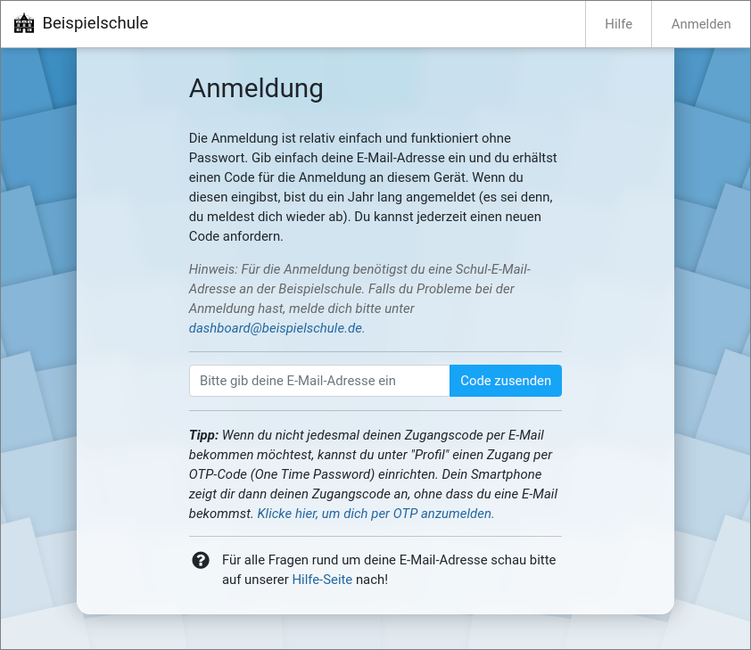

# Schul-Dashboard

Das Schul-Dashboard wurde am [Gymnasium Steglitz](https://gymnasiumsteglitz.de/) entwickelt, um SuS und Lehrkräften einen Einstiegspunkt für die täglichen Abläufe im Distanzunterricht zu bieten.

Erste Schritte und Betrieb:

- [Installation](file.Installation.html)
- [Daten](file.Daten.html)
- [Betrieb](file.Betrieb.html)
- [Nextcloud](file.Nextcloud.html)

Entwicklung:

- [Architektur](file.Architektur.html)
- [Entwicklerhandbuch](file.Development.html)
- [Tests](file.Tests.html)

Funktionen:

- [Sitzplanhelfer](file.Sitzplanhelfer.html)

Es gibt ein paar Videos, die zeigen, worum es dabei geht:

- [Dashboard am Gymnasium Steglitz (Kurzversion für Schülerinnen und Schüler)](https://youtu.be/EGQ0Gkeu1To)
- [Dashboard am Gymnasium Steglitz (ausführliche Version für Lehrkräfte)](https://youtu.be/BYqWu9Yft8s)

In diesem Video wird die schnelle Einrichtung eines Testsystems beschrieben:

- [Starte dein eigenes Schul-Dashboard in 6 Minuten](https://youtu.be/n_n6gJdkBxY)
